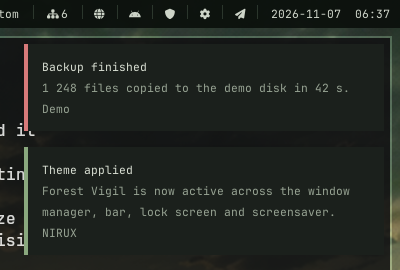

# NIRUNOTIFY

Native notification service, hardware OSD and event-sound player for the NIRUX desktop.

**Status: beta** · Part of the [NIRUX](https://github.com/nirucon/nirux) suite · [MIT License](LICENSE)



## About

NIRUNOTIFY owns `org.freedesktop.Notifications` on the session bus and draws
plain, themed notification popups on X11. It also shows the volume and
brightness OSD and plays the NIRUX event sounds (volume ticks, charger,
battery, devices, lock), so the rest of the suite has one place for all
feedback.

It only takes the bus name when no other provider is active and never evicts
an existing one; NIRUWM falls back to Dunst when NIRUNOTIFY is not installed.

## Features

- Replacement IDs, timeouts, close reasons, urgency accents, clickable actions
  and `ActionInvoked`; advertised capabilities are `body` and `actions` (no
  markup or images).
- Popups follow the active NIRUWM theme live, stay above ordinary windows
  without taking keyboard focus and keep clear of the bar.
- Monitor selection per surface: the NIRUWM focused screen (default), the
  pointer, the RandR primary or a named output. Follows hotplug and docking,
  and keeps clear of the bar on that screen only.
- Do Not Disturb, critical-timeout policy and memory-only history (100
  entries), controlled over a Unix-socket CLI.
- Suppressed while NIRULOCK's `_NIRU_LOCK_READY` names a live lock window.
- Hardware OSD for volume and brightness: label, icon, the value and a level
  bar in the theme accent that glides to the new level. A held key reuses the
  same box, `Muted` keeps the last level greyed out and a press against 0 %
  or 100 % lights the bar briefly. For example `nirunotify --osd volume 45%`.
- NIRUX system sounds played natively, without a shell: volume, mute,
  brightness, screenshot, charger, battery, devices (USB, audio, monitors,
  optionally Bluetooth) and lock. Charger and device events come from kernel
  uevents, with no polling.
- One coalescing sound worker, so a notification burst cannot stack audio or
  leave zombie processes; bounded maps and a 100-command queue.

## Requirements

- Debian, Arch or Void Linux (glibc), x86_64, with X11 and a session D-Bus.
- For sounds: the NIRUX sound set and a PipeWire/PulseAudio player; `wpctl` to
  respect a muted sink.
- Building from source: Rust and `cargo`.

## Installation

### With NIRUX

NIRUNOTIFY is a core component. `nirux install` installs it with the rest of
the suite, `nirux update` keeps it current, and `niruwm-session` starts it at
login. See the [NIRUX README](https://github.com/nirucon/nirux#installation).

### Standalone

```sh
git clone https://github.com/nirucon/nirunotify
cd nirunotify
./install.sh            # download the released x86_64/glibc binary
./install.sh --build    # or build from this checkout (needs cargo)
```

The binary goes to `~/.local/bin` (override with `NIRUNOTIFY_PREFIX`). Start
`nirunotify` from your session; it exits with a clear error if another daemon
already owns the bus name.

## Usage

```sh
nirunotify                                   # run the service
notify-send "Hello" "Body"                   # any client works
nirunotify --dnd on|off|toggle|status
nirunotify --history
nirunotify --count
nirunotify --dismiss ID
nirunotify --clear
nirunotify --osd volume 45                   # OSD channel and text
nirunotify --osd volume 45% --sound volume-up 45
nirunotify --sound auth-fail
nirunotify --check-config
nirunotify --version
```

### System sounds

`nirunotify --sound EVENT [LEVEL] [muted|unmuted]` plays a NIRUX sound event:
`volume-up`, `volume-down`, `volume-limit`, `mute`, `unmute`, `brightness-up`,
`brightness-down`, `screenshot`, `power-plug`, `power-unplug`, `battery-low`,
`battery-critical`, `battery-full`, `device-connect`, `device-disconnect`,
`auth-fail`, `lock`, `unlock` and the session events. `--osd ... --sound ...`
shows the OSD and plays the sound in one call; `LEVEL` picks the volume tick
for the new level, and `unmuted` saves a `wpctl` call when the caller already
knows the sink state. Other programs can send the same request as one line,
`sound EVENT`, on the control socket.

The sound settings belong to NIRUX: `~/.config/nirux/sounds.toml`, managed with
`nirux sounds` and reread when the file changes. Sound files are
`~/.config/nirux/sounds/EVENT.ogg` (yours) or the NIRUX ones under
`$NIRUX_PREFIX/share/nirux/sounds`. A held key plays at most one tick per
`rate_limit_ms`; Do Not Disturb silences notification sounds only; a muted sink
silences everything when `respect_mute` is on. See
[NIRUX sounds](https://github.com/nirucon/nirux/blob/main/docs/SOUNDS.md).

Charger, battery and device events come from one thread that sleeps on a
kernel uevent socket: the charger (`power_supply` Mains/USB `online`), the
machine's batteries (`capacity`, `status`; peripherals with `scope = Device`
are ignored), `usb` devices (not interfaces or root hubs), `sound` cards, `drm`
connector status (monitors) and, when enabled, `bluetooth` links. A burst such
as plugging in a dock is one sound, and the charger wins over its devices.

The sound for a notification is played by `nirux sounds play notification
--app APP`, one at a time with bursts coalesced, so the per-app sounds set with
`nirux sounds app` and `notification_exclude_apps` apply. In NIRUX, `nirux manual
notifications` and `nirux manual event sounds` describe the whole setup.

## Configuration

Settings live in `~/.config/nirunotify/config.toml`; start from
[config.example.toml](config.example.toml). Colours are not duplicated: popups
follow `theme` in `~/.config/niruwm/config.toml`, and font and spacing come
from the shared NIRUWM appearance unless set here.

| Key | Default | Meaning |
|---|---|---|
| `width` | `360` | Popup width in pixels |
| `margin` | `12` | Gap from the screen edge and between popups |
| `max_visible` | `5` | Visible popups; older ones stay in history |
| `default_timeout_ms` | `6000` | Timeout when a client sends -1 |
| `max_timeout_ms` | `60000` | Upper bound for any timeout, including a persistent 0 |
| `critical_timeout_ms` | `30000` | Timeout for urgent notifications |
| `critical_ignore_dnd` | `false` | Let urgent notifications through DND |
| `monitor` | `""` | Empty or `focused` = NIRUWM focused screen, `pointer`, `primary`, or an output name |
| `position` | `top-right` | `top-right`, `top-left`, `bottom-right` or `bottom-left` |
| `font_size`, `font_path` | `14.0`, unset | Font override |

`nirunotify --check-config` prints the effective settings and what the uevent
watcher reads now.

## Files and paths

| Path | Purpose |
|---|---|
| `~/.config/nirunotify/config.toml` | Notification settings |
| `~/.config/nirux/sounds.toml` | Event-sound settings (owned by NIRUX) |
| `~/.config/nirux/sounds/EVENT.ogg` | Your replacement sounds |
| `$XDG_RUNTIME_DIR/nirunotify-UID.sock` | Control socket used by the CLI |
| `~/.local/bin/nirunotify` | Program |

## Troubleshooting

- **"cannot own org.freedesktop.Notifications".** Dunst or another notification
  service is running; stop it, or set `NOTIFICATION_PROVIDER` in
  `~/.config/niruwm/session.conf`.
- **"NIRUNOTIFY daemon is not running".** The CLI talks to the running service
  over its socket; start `nirunotify` first.
- **A sound does not play.** `NIRUNOTIFY_DEBUG_SOUNDS=1 nirunotify` explains
  each decision on stderr; `nirux sounds status` shows what is switched on.
- **No popups while the screen is locked.** That is intentional.

## Uninstall

With NIRUX, use `nirux uninstall`. A standalone install is removed with:

```sh
./install.sh --uninstall
```

Configuration is kept.

## Building from source

```sh
cargo build --release --locked
cargo fmt --check
cargo clippy --all-targets -- -D warnings
cargo test
sh tests/ui-smoke.sh target/release/nirunotify
sh tests/sounds-smoke.sh target/release/nirunotify
```

`tests/fixtures/sounds-default.toml` is the `sounds.toml` a new NIRUX writes
(`sounds.example.toml` in NIRUX); keep the two identical.

## Status, disclaimer and how it's made

**Status: beta.** NIRUNOTIFY has replaced Dunst on all my machines; the
event-sound side is newer and still being tuned.

NIRUX and every niru* project are made by me, Nicklas Rudolfsson
([@nirucon](https://github.com/nirucon)), for me. They are tailored to my own
needs, preferences and workflows, on my own machines. If they fit yours too,
that's a nice bonus.

- **Free and open source.** Anyone is free to use, study, change and share
  it under the [MIT License](LICENSE).
- **No guarantees.** There is no warranty of any kind. Use it at your own
  risk, read what you install and keep backups of anything that matters.
- **How it's made.** Some of these projects I built from scratch by hand. In
  more recent releases I have used Claude, Anthropic's AI, to do much of the
  heavy lifting under my direction: I decide what to build and how it should
  behave, and I test it on my own machines. It saves me a lot of time, and
  the result is quite OK.
- **Alpha, beta, dev, and maybe forever.** Most things here are alpha, beta
  or dev, and may stay that way. Maybe one day there will be a real stable
  release, but given how fast development moves, and how I am as a person,
  maybe never :)

| Label | Meaning |
|---|---|
| dev | Under active construction; may not build, install or work yet. |
| alpha | Works on my machines, but incomplete or rough; expect breaking changes. |
| beta | In daily use on my machines and mostly complete; rough edges remain. |

## License

MIT License, see [LICENSE](LICENSE). Copyright (c) 2026 Nicklas Rudolfsson.
